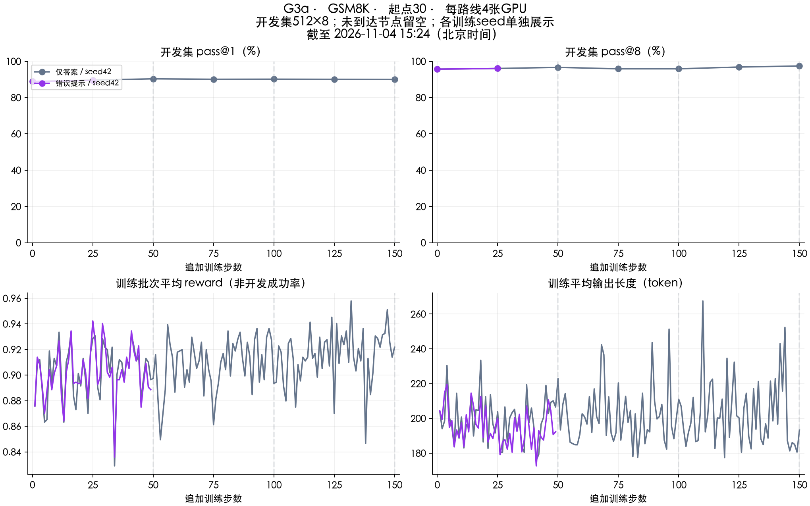

# G3a进度与初步结果

采集时间：2026-11-04 15:24:06（北京时间）。这是静态快照。

18条训练中，5条完成、2条正在跑、11条待跑。已完成的5条包括2条准备训练和3条正式对比；90步存档出发的8条对比尚未开始。

下面列出已经开始的路线。正式对比目前均从30步存档出发；训练进度与最近测验步分别列出。两个分数是开发集pass@1和pass@8，口径为512题×8次。

| 实验 | 训练进度 | 最近测验步 | pass@1 | pass@8 |
|---|---:|---:|---:|---:|
| K&K：准备训练 | 完成150步 | 150 | 45.36% | 89.84% |
| GSM8K：准备训练 | 完成150步 | 150 | 89.28% | 95.51% |
| K&K：错误提示 | 完成150步 | 150 | 27.17% | 74.02% |
| K&K：完整解法 | 完成150步 | 150 | 0.07% | 0.59% |
| K&K：只给答案 | 141/150步 | 125 | 40.99% | 88.87% |
| GSM8K：只给答案 | 完成150步 | 150 | 90.01% | 97.46% |
| GSM8K：错误提示 | 49/150步 | 25 | 89.45% | 96.09% |

准备训练的测验步数从原始学生开始计；正式分支的测验步数是从存档继续训练的步数。准备训练不是同起点追加150步的正式不给提示对照。

最明显的质量变化是K&K完整解法条件退化到单次0.07%。训练中出现短回答和答案缺失，已有CPU评分复核，具体机制未确定。保留完整150步终点，没有改挑中途较好checkpoint。

GSM8K只给答案的150步开发结果为90.01%/97.46%。这些数值不能单独证明指导优势：不给提示的正式追加对照、90步起点组和独立终测尚未完成；单训练种子也不能估计换种子后的波动。

剩余11条是90步存档出发的8条，以及30步存档出发的K&K不给提示、GSM8K不给提示和完整解法。

## 学习曲线

上排为开发集成功率，下排为训练批次reward和输出长度，二者不要混读。

[逐点CSV](../results/g3a/development.csv) · [18条路线与来源哈希](../results/g3a/summary.json) · [实验设计](g3a-study.md)
