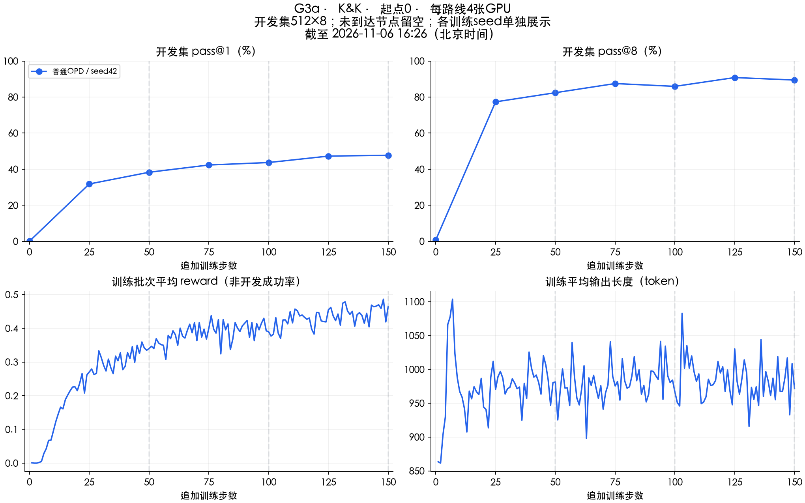

# 当前进度与结果

快照时间：2026-11-06T16:26:35.752464+08:00，**clean-v4**。静态快照；[SwanLab新轮](https://swanlab.cn/@Tasselszcx/OPD+RL/runs/d865445ade5e2c67474c)同步运行日志。

公共参考从官方Base重新训练，完成**150／150步**，使用4张GPU，不计入正式八组。参考完成并保留新30／90状态后，先跑30起点四组，再跑90起点四组，各追加150步。

| 学生起点 | 指导 | 已完成／计划更新 | 状态 | 最近开发测于追加步 | pass@1／pass@8 |
|---:|---|---:|---|---:|---|
| 30 | Baseline | 0／150 | 初始化／起始验证 | — | 待验证 |
| 30 | 只给答案 | 0／150 | 初始化／起始验证 | — | 待验证 |
| 30 | 完整解法 | 0／150 | 等待公共参考完成 | — | 待验证 |
| 30 | 针对错误提示 | 0／150 | 等待公共参考完成 | — | 待验证 |
| 90 | Baseline | 0／150 | 等待公共参考完成 | — | 待验证 |
| 90 | 只给答案 | 0／150 | 等待公共参考完成 | — | 待验证 |
| 90 | 完整解法 | 0／150 | 等待公共参考完成 | — | 待验证 |
| 90 | 针对错误提示 | 0／150 | 等待公共参考完成 | — | 待验证 |

正式八组完成**0／8**。分数对应表内测验步数，不代表当前未测步数；单训练种子，暂不下指导优劣或状态交互结论。

## 训练后开发成绩

| 路线 | 起点 | 指导 | 追加步／全局步 | pass@1 | pass@8 | 平均token | 长度上限率 | 未触限缺答案标签 |
|---|---:|---|---:|---:|---:|---:|---:|---:|
| 公共参考 | 0 | Baseline | 25／25 | 31.81% | 77.34% | 1185.1 | 7.15% | 0.00% |
| 公共参考 | 0 | Baseline | 50／50 | 38.31% | 82.42% | 1031.3 | 4.20% | 0.02% |
| 公共参考 | 0 | Baseline | 75／75 | 42.33% | 87.50% | 1114.3 | 4.88% | 0.29% |
| 公共参考 | 0 | Baseline | 100／100 | 43.70% | 85.94% | 1042.2 | 4.00% | 0.46% |
| 公共参考 | 0 | Baseline | 125／125 | 47.27% | 90.82% | 1086.5 | 4.08% | 0.51% |
| 公共参考 | 0 | Baseline | 150／150 | 47.73% | 89.45% | 1070.8 | 4.27% | 0.37% |

开发集固定512题×8次，每25步记录；固定终点另做独立测试1024题×32次。格式完整也不代表逻辑答案全对，所有不合法或错误答案仍按原评分规则计错。

## 历史与检查

修复从参考训练第1步生效，禁止旧参考起点。旧轮结果、调试对照和成本保留在[历史探索](../results/g3a/legacy-format-v3-20261105/README.md)，不计入新轮。

[新轮快照](../results/g3a/summary.json) · [八组进度](../results/g3a/formal-progress.csv) · [开发点](../results/g3a/development.csv) · [检查范围](validation.md) · [实验设计](g3a-study.md)

