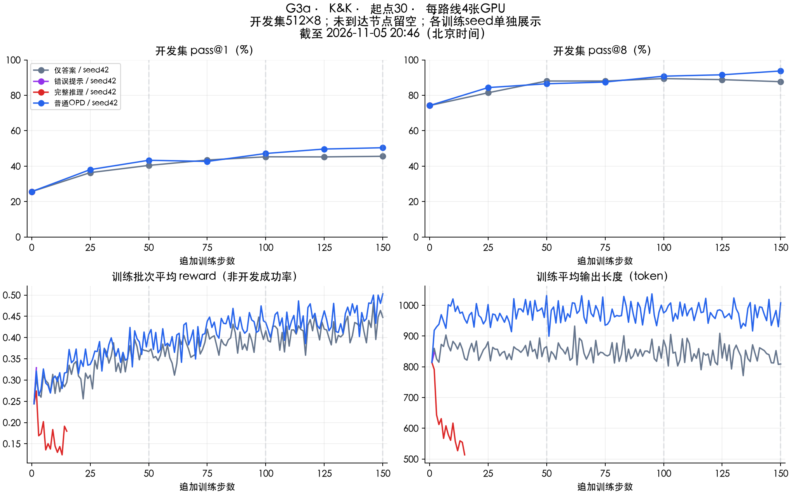

# 旧参考起点探索：已停止

旧轮format-v3追加训练已修复EOS和换行，但30／90起点来自更早的参考训练。2026-11-06按用户要求停止并重建起点；这里的分数不属于clean-v4。

| 起点30的指导 | 实际训练更新 | 最后完整开发测于追加步 | pass@1 | pass@8 | 结束原因 |
|---|---:|---:|---:|---:|---|
| Baseline | 150 | 150 | 50.42% | 93.75% | 完成 |
| 只给答案 | 150 | 150 | 45.58% | 87.70% | 完成 |
| 完整解法 | 64 | 50 | 26.07% | 66.80% | 用户要求重建 |
| 针对错误提示 | 46 | 25 | 35.30% | 82.23% | 用户要求重建 |

90步起点未开始，独立终测未开始。不同测验预算的分数不直接作方法排名。答案组相对baseline的固定150步开发差值为−4.83／−6.05个百分点；逐题区间见[原配对结果](formal-dev150-comparison.json)，不代表训练种子间不确定性。

[最终停止摘要](final-stopped-summary.json) · [原发布结果说明](RESULTS.original.md) · [原方案](STUDY.original.md) · [全部旧开发点](development.csv) · [旧修复对照](diagnostic-newline25.csv)

此图和原始发布数据保留各自快照时间。`summary.original.json`保留原文件；`summary.json`仅修正由原路线行可核对的旧计数错误，分数未改。更早记录见[旧18路线](../legacy-20261104/LEGACY_STATUS.md)。[返回clean-v4](../README.md)
